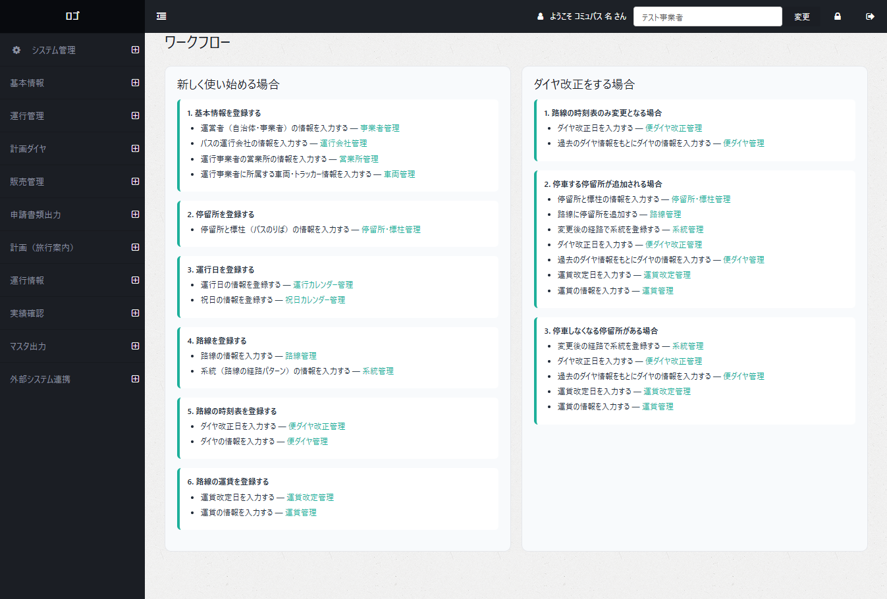

# コミュニティバス運行支援キット

## 更新履歴

| 更新日時 | リリース | 更新内容 |
|---|---|---|
| 2026/2/27 | 1st Release | 初版リリース |

---

## 1. 概要

本リポジトリでは、国土交通省が推進する[Project LINKS](https://www.mlit.go.jp/links/)及び地域交通DXプロジェクト[COMmmmONS（コモンズ）](https://www.mlit.go.jp/commmmons/)が連携した2025年度の取組である「コミュニティバスキット開発プロジェクト」について、その成果物である「コミュニティバス運行支援キット」（以下、「コミュバスキット」）のソースコードを公開しています。

「コミュバスキット」は、コミュニティバスを運行する地方公共団体など中小規模のバス事業者でも導入可能なオープンソースソフトウェア（OSS）であり、運行計画管理、運行実績集計、車両動態管理、GTFS（Schedule/RT）出力等のコミュニティバス運営に必要な一連の運行支援機能を提供するシステムです。

---

## 2. 「コミュニティバスキット開発プロジェクト」について

[「コミュニティバスキット開発プロジェクト」](https://www.mlit.go.jp/commmmons/projectreport/11_01/)では、少数台で運行されるコミュニティバスにおいて、運行計画の管理、実績集計、GTFSデータ整備、行政機関への届出対応等の業務を効率化・高度化することを目的として、本システムを開発しました。

現在、多くの中小規模事業者や自治体では、運行情報や実績情報が分散管理されており、業務効率上の課題となっています。  
また、GTFSデータの整備・更新も個別ツールに頼っており、持続的なデータ作成が課題となっています。  
こうした現状を踏まえ、本プロジェクトでは、本システムの提供によって日常業務の効率化や、その延長線上でGTFSデータを整備・活用できる環境を提供し、業務負担の軽減や経路案内サービスへのデータ搭載による公共交通の利用促進を図ることを目的としています。

本システムは、国土交通省が推進する公共交通データ標準化の取組と整合する形で、[GTFS-JP](https://www.mlit.go.jp/sogoseisaku/transport/sosei_transport_tk_000067.html)に対応したデータ出力機能を備えています。
また、自治体ごとに異なる申請様式や運用形態に柔軟に対応できるよう、OSSとして公開し、改変・拡張が可能な構成としています。

本システムの技術的な詳細については、技術検証レポート（2026年3月公開予定）を参照してください。

---

## 3. 利用手順

本システムの[構築手順](./devMan.md)及び利用手順については[利用マニュアル](https://www.test2.go.jp/)を参照してください。

---

## 4. システム概要

### ①運行計画作成
- 運行会社、車両、停留所、路線、系統、便ダイヤ、在庫、運賃など、運行計画に必要な各種データを総合的に管理します。
- 各データは入力フォームから登録できるほか、停留所など一部のデータについては地図上で位置を確認しながらプロットすることが可能です。

### ②運行管理
- 車両に搭載されたGPSトラッカーなどの外部デバイスから車両動態情報を取得し、運行中の車両位置を把握することができます。
- 取得した動態情報は、後続の実績集計やGTFS-RT出力にも活用されます。

### ③実績集計
- 運行実績や売上実績など、日々の運行により発生する各種実績データを蓄積・管理します。
- これにより、路線・系統単位での運行状況の把握や、行政機関への報告に必要な基礎データを整理することができます。

### ④GTFS出力
- 運行計画で作成した静的データをGTFS Scheduleとして、また、運行管理で取得した動態情報をGTFS Realtimeとしてエクスポートすることができます。

### ⑤データインポート機能
- 収入情報など、外部システムや別管理されているデータをインポートすることが可能です。
- また、路線図、時刻表、運賃表など、通常はフォーム入力で登録する各種データについても、CSV等を用いた一括インポートに対応しています。

### ⑥届出・申請書類作成支援
- 省庁や各自治体向けの届出申請書類、補助金・助成金申請書類の作成に利用できるデータ一覧をエクスポートします。
- 申請書類のフォーマットは自治体ごとに異なるため、本システムでは特定の様式に限定した帳票作成は行わず、利用者がカスタマイズしやすい形でデータを出力することを前提としています。

---

## 5. 利用技術

| 種別 | 名称 | バージョン | 内容 |
|---|---|---|---|
| フレームワーク | Spring Boot | 3.5.3 | Java 用フレームワーク |
| データベース | PostgreSQL | 2.4 | 各データ格納用リレーショナルデータベース |
| ユーティリティ | pg_dump | - | PostgreSQLユーティリティ（バックアップ取得） |
| ユーティリティ | pg_restore | - | PostgreSQLユーティリティ（バックアップ復元） |
| 業務ロジック | 車両通過判定 | - | 車両に搭載されているGPSトラッカーから送信されてくる緯度経度の情報を基に、停留所（標柱）の到着・通過判定を行う。 |
| 仮想サーバー | Amazon EC2 | - | AWS上の仮想サーバー（OS、CPU、メモリを選択し使用）。コミュニティバス支援システムを動作させる実行環境として使用する。 |
| ストレージ | Amazon EBS | - | EC2と接続するストレージ。データを永続的に保存するために使用する。 |
| ストレージ | Amazon S3 | - | GTFS Realtime保存用ストレージ。GTFS Realtimeを保存するために使用する。 |
| イベント実行 | Amazon Lambda | - | GPSトラッカー情報を受信するために使用する。 |
| メール送信 | Amazon SES | - | メール送信サービス。二要素認証メールを送信するために使用する。 |

---

## 6. 動作環境

| 項目 | 最小動作環境 | 推奨動作環境 |
|---|---|---|
| OS | Microsoft Windows 11 | 同左 |
| CPU | Intel Core i5以上 | 同左 |
| メモリ | 8GB以上 | 同左 |
| ディスプレイ解像度 | 1920×1080以上 | 同左 |

---

## 7. 本リポジトリのフォルダ構成

本リポジトリ（community-bus-kit）直下には、以下のサブプロジェクト／コンポーネントが配置されています。

| フォルダ名 | 詳細 |
|---|---|
| bus-service-management-system | Webアプリケーション（運行計画管理・運行管理・実績集計・GTFS出力 等） |
| daily-bus-daiya-batch | 日毎便ダイヤ作成バッチ |
| output-gtfs-rt-batch | GTFS-RT出力バッチ |
| oss-bus-gps-tracker-import-lambda | GPSトラッカー取込Lambda |

### 7.1 Webアプリケーション（bus-service-management-system）

| フォルダ名 | 詳細 |
|---|---|
| src/ | ソース一式 |
| src/builds/ | ビルド・環境別の設定ファイル一式 |
| src/builds/config/ | 環境別設定（application.yml / logback 等） |
| src/docs/ | ドキュメント・画像など（READMEで参照する資料） |
| src/docs/images/ | README等で参照する画像 |
| src/main/ | アプリケーション本体 |
| src/main/java/ | Javaソースコード |
| src/main/java/maint/ | アプリのルートパッケージ |
| src/main/java/maint/config/ | 設定（セキュリティ/エラーハンドリング等） |
| src/main/java/maint/constants/ | 定数定義 |
| src/main/java/maint/controller/ | Controller層（画面/機能の入口） |
| src/main/java/maint/doc/ | 帳票（Excel）入出力関連 |
| src/main/java/maint/dto/ | DTO（画面/帳票向けデータ） |
| src/main/java/maint/entity/ | Entity（DBテーブル対応モデル） |
| src/main/java/maint/enums/ | Enum定義 |
| src/main/java/maint/exception/ | 例外定義 |
| src/main/java/maint/form/ | Form（画面入力・検索条件など） |
| src/main/java/maint/handler/ | 各種ハンドラー |
| src/main/java/maint/mapper/ | MyBatis Mapper（DBアクセスのインターフェース） |
| src/main/java/maint/message/ | メッセージ関連 |
| src/main/java/maint/properties/ | プロパティ定義/バインド用 |
| src/main/java/maint/provider/ | 認証/ユーザー情報等のProvider |
| src/main/java/maint/service/ | Service層（業務ロジック） |
| src/main/java/maint/session/ | セッション管理 |
| src/main/java/maint/utils/ | ユーティリティ |
| src/main/java/maint/validation/ | バリデーション（独自Validator/アノテーション等） |
| src/main/resources/ | リソース一式（設定・テンプレート・静的ファイル・SQL定義等） |
| src/main/resources/templates/ | 画面テンプレート（Thymeleaf） |
| src/main/resources/static/ | 静的ファイル（JS/CSS/画像/フォント等） |
| src/main/resources/mapper/ | MyBatis Mapper XML（SQL定義） |
| src/main/resources/excel/ | Excelテンプレート（帳票出力/取込用） |
| src/main/resources/mail/ | メールテンプレート（FreeMarker） |
| src/main/resources/META-INF/ | Spring設定メタ情報 |
| src/test/ | テスト一式 |
| src/test/java/ | テストコード |
| src/test/java/maint/ | アプリケーションテスト |

### 7.2 日毎便ダイヤ作成バッチ（daily-bus-daiya-batch）

| フォルダ名 | 詳細 |
|---|---|
| src/ | ソース一式 |
| src/build/ | ビルド・環境別の設定ファイル一式 |
| src/build/bin/ | 実行・運用補助用スクリプト等（起動/停止など） |
| src/build/config/ | 環境別設定（DB接続、ログ設定等） |
| src/main/ | バッチアプリケーション本体 |
| src/main/java/ | Javaソースコード |
| src/main/java/jp/co/bus/batch/ | バッチ処理のルートパッケージ |
| src/main/java/jp/co/bus/batch/constants/ | 定数定義 |
| src/main/java/jp/co/bus/batch/dao/ | DAO（DBアクセス） |
| src/main/java/jp/co/bus/batch/dto/ | DTO（入出力データ） |
| src/main/java/jp/co/bus/batch/enums/ | Enum定義 |
| src/main/java/jp/co/bus/batch/exception/ | 例外定義 |
| src/main/java/jp/co/bus/batch/factory/ | Factory（生成・組み立て） |
| src/main/java/jp/co/bus/batch/properties/ | 設定値の取り扱い |
| src/main/java/jp/co/bus/batch/service/ | 業務ロジック |
| src/main/java/jp/co/bus/batch/utils/ | ユーティリティ |
| src/main/java/jp/co/bus/batch/Main.java | バッチ実行エントリポイント |
| src/main/resources/ | リソース一式（設定・Mapper等） |

### 7.3 GTFS-RT出力バッチ（output-gtfs-rt-batch）

| フォルダ名 | 詳細 |
|---|---|
| src/ | ソース一式 |
| src/build/ | ビルド・環境別の設定ファイル一式 |
| src/build/bin/ | 実行・運用補助用スクリプト等（起動/停止など） |
| src/build/config/ | 環境別設定（DB接続、S3出力先、ログ設定等） |
| src/main/ | バッチアプリケーション本体 |
| src/main/java/ | Javaソースコード |
| src/main/java/jp/co/bus/batch/ | バッチ処理のルートパッケージ |
| src/main/java/jp/co/bus/batch/constants/ | 定数定義 |
| src/main/java/jp/co/bus/batch/dao/ | DAO（DBアクセス） |
| src/main/java/jp/co/bus/batch/dto/ | DTO（入出力データ） |
| src/main/java/jp/co/bus/batch/enums/ | Enum定義 |
| src/main/java/jp/co/bus/batch/exception/ | 例外定義 |
| src/main/java/jp/co/bus/batch/factory/ | Factory（生成・組み立て） |
| src/main/java/jp/co/bus/batch/properties/ | 設定値の取り扱い |
| src/main/java/jp/co/bus/batch/service/ | 業務ロジック |
| src/main/java/jp/co/bus/batch/utils/ | ユーティリティ |
| src/main/java/jp/co/bus/batch/Main.java | バッチ実行エントリポイント |
| src/main/resources/ | リソース一式（設定・Mapper等） |

### 7.4 GPSトラッカー取込Lambda（oss-bus-gps-tracker-import-lambda）

| フォルダ名 | 詳細                  |
|---|---------------------|
| src/ | ソース一式               |
| src/build/ | ビルド・環境別の設定ファイル一式    |
| src/build/config/ | 環境別設定（DB接続、外部連携設定等） |
| src/main/ | Lambda関数本体          |
| src/main/java/ | Javaソースコード          |
| src/main/java/communitybus/ | ルートパッケージ            |
| src/main/java/communitybus/lambda/ | Lambda本体            |
| src/main/java/communitybus/lambda/constants/ | 定数定義                |
| src/main/java/communitybus/lambda/dao/ | DAO（DBアクセス）         |
| src/main/java/communitybus/lambda/dto/ | DTO（入出力データ）         |
| src/main/java/communitybus/lambda/entity/ | Entity（DBモデル）       |
| src/main/java/communitybus/lambda/enums/ | Enum定義              |
| src/main/java/communitybus/lambda/exception/ | 例外定義                |
| src/main/java/communitybus/lambda/factory/ | Factory（生成・組み立て）    |
| src/main/java/communitybus/lambda/properties/ | 設定値の取り扱い            |
| src/main/java/communitybus/lambda/response/ | レスポンスモデル            |
| src/main/java/communitybus/lambda/service/ | 業務ロジック              |
| src/main/java/communitybus/lambda/utils/ | ユーティリティ             |
| src/main/java/communitybus/lambda/LambdaRequestHandler.java | Lambdaエントリポイント      |
| src/main/resources/ | リソース一式（設定・Mapper等）        |

---

## 8. ライセンス

- ソースコード及び関連ドキュメントの著作権は国土交通省に帰属します。

---

## 9. 注意事項

- 本リポジトリは参考資料として提供しているものです。動作保証は行っていません。
- 本リポジトリについては予告なく変更又は削除をする可能性があります。
- 本リポジトリの利用により生じた損失及び損害等について、国土交通省はいかなる責任も負わないものとします。

---

## 10. 参考資料
- コミュニティバスキット開発プロジェクト　プロジェクトレポート
    - #1　https://www.mlit.go.jp/commmmons/projectreport/11_01/

- 技術検証レポート: （2026年3月公開予定）
